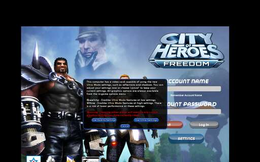

# M2 report: the original client boots on ARM64

Date: 2026-10-22. Branch `armport/m2-client`. Evidence: CI run
[39742143066](https://github.com/Russianranger/coh-android/actions/runs/39742143066)
(`ArmPort build`, `ubuntu-24.04-arm`, commit `1cb246f`).

## Exit test: login screen reached (server part not run yet)

`CityOfHeroes.exe`, built from the original client source as an ARM64 Windows
program (llvm-mingw 20250910), runs under the app's ARM64 Wine 10
(`android/runtime-lock.json`) on Xvfb with Mesa llvmpipe and shows the login
screen: the Freedom art, Account Name and Account Password fields, the
Log In and Settings buttons, and the game's own Ultra Mode prompt on top.

The screen is exported from the run (`ArmPort screen` annotations of job
`client-run`; OCR of the same frame reads the Ultra Mode prompt). The client
was still running and drawing at 180 s, when the smoke script stops it; there
were no exceptions.

Not yet done from the plan's exit test: "against the CI server". This run
does not start the server stack, and the client only contacts the auth
server when Log In is pressed. The scripted login against the CI server is
the first step of M3; it is called out here so the review can decide whether
M2 counts as passed.

## How CI gets there

| Job | What it does |
|---|---|
| `client` | Release and OptDebug builds (`-gline-tables-only`, cached by build inputs) |
| `client-run1` | OptDebug client with `-createbins` writes the data bins (FINAL builds only read bins); the Release client then runs once and records the Cg programs it needs |
| `cg-precompile` | The original `cgc.exe` on a Windows runner compiles those programs to ARB assembly (272 programs) |
| `client-run` | Release client with the bins and ARB programs; screen, OCR, window texts, stdio log and symbolized exceptions come back as annotations |

The data is the repo's `upstream/i24/data` plus the reviewed client asset
bundle the other runtime workflows use (release asset 588984151, sha256
checked), as loose files. No piggs.

## What it took

Patches 0009-0043 (`armport/patches/series`, nothing in `upstream/` edited):

- Compile and link (0009-0027): prototypes, lvalue casts, consistent
  declarations, include case, ARM64 paths for texWords, frustum, prefetch,
  PhysX off, CMake for nvparse/CubeMapGen and the stand-ins, MSVC `min`/`max`
  for C, the `WinMain` entry under the mingw CRT.
- Running under Wine (0028, 0029, 0041): stdio log for CI, SuperAssert on
  ARM64, scene load diagnostics.
- 64-bit fixes (0030-0040, 0043): file layouts (DDS, `.anim`, `.geo` and its
  v2 records), find handles, `LRESULT`, evaluator and hash-table pointers,
  pointer arrays described as int arrays, SMF font faces kept in int stacks,
  the font-height cache key. Each is listed with its symptom in
  `notes/64BIT-AUDIT.md`. Wine places a 64-bit program's memory above 4 GB
  (measured), so these had to be fixed rather than tolerated.
- Loose data (0042): production clients read `scenes/`, `ent_types/`,
  `object_library/` and `geobin/` only from piggs; `ARMPORT_LOOSE_DATA=1`
  (set only by the smoke script) lifts that for CI's loose data.

Stand-ins for x86-only libraries (`armport/standins/`):

- Cg: 27 functions are real (ARB programs looked up by a hash of profile,
  entry, args and source; misses are recorded for `cg-precompile`), 54 are
  stubs.
- nvDXT: DDS decoding (DXT1/3/5, uncompressed RGB/RGBA) for UI sprites,
  checked identical to Pillow on generated files; compression reports
  failure.
- PhysX ragdolls and MSVC intrinsics (`__cpuid` reports no SSE).

## Known gaps

- No ragdolls, CgFX effects (SSAO, filters) or runtime DXT compression.
- CI has no `.geo` files for many `object_library/Item_library` props
  (warnings, models absent); real installs have them in piggs.
- Not yet reviewed for 64-bit: `DirMonitor.c` completion key (dev mode only),
  `SOCKET` values in `int` in the network library (small under Wine; first
  thing to check if M3 networking misbehaves).
- The Ultra Mode prompt appears on every fresh profile; M3's script will
  answer it.

## Next (M3)

Start the CI server stack in this workflow, script the login to Atlas Park,
replay the saved native-android packets through the original receive code,
and check the screen.
